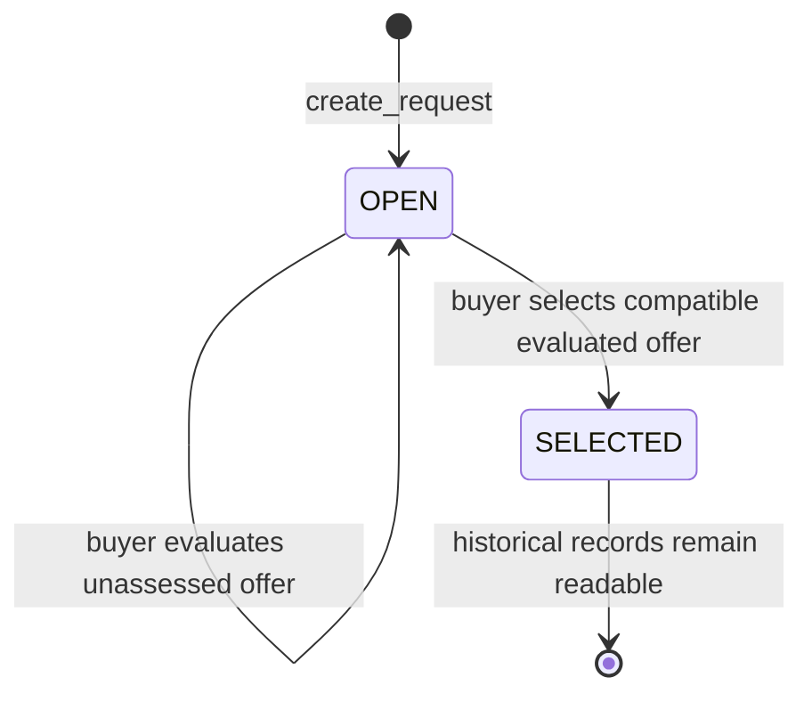

# SpecCheck architecture

## Trust case

A procurement buyer wants to compare multiple supplier statements against the same mandatory requirements. SpecCheck records a stable specification and submitted quotation, obtains independently checked AI decisions, and records which eligible offer the buyer selected. The contract does not decide whether to pay or whether physical goods are authentic.

The buyer is the sender of `create_request`. Each offer's submitter is the sender of `submit_offer`. Supplier labels are self-declared text. These addresses provide transaction provenance, not verified real-world identities.

## Components

| Component | Responsibility |
| --- | --- |
| `contracts/speccheck.py` | Persistent records, access control, nondeterministic assessment, deterministic verdicts, selection |
| `src/app.js` / `src/style.css` | Request workspace, comparison matrix, evidence display, wallet actions, recorded-demo mode |
| `src/chain.js` | Studionet reads, wallet-signed writes, pending-hash recovery, state read-back |
| `src/receipt.js` | Distinguishes lifecycle status from successful contract execution |
| `public/deployment.json` | Configured network and verified deployment address |
| `scripts/live-test.mjs` | Public synthetic workflow using two project-controlled test wallets |
| `public/evidence/demo.json` | Generated demonstration archive; not a live RPC response |

The target is stable Studionet: RPC `https://studio.genlayer.com/api`, chain ID 61999. JavaScript uses `genlayer-js` 1.1.8. The Python contract pins `py-genlayer:1jb45aa8ynh2a9c9xn3b7qqh8sm5q93hwfp7jqmwsfhh8jpz09h6`.

## Storage and immutable inputs

All persistent records use `TreeMap[str, str]` containing canonical JSON, with a `DynArray[str]` request index. Ordinary Python lists and dictionaries exist only in memory. The storage layout is:

| Field | Stored content | Mutation rule |
| --- | --- | --- |
| `requests` | ID, title, buyer, requirements | Written once per request ID |
| `offers` | ID, request ID, submitter, supplier label, original evidence, digest | Written once per offer ID |
| `assessments` | Evaluation status, aggregate verdict, per-requirement items | Written once per offer ID after consensus |
| `selections` | Request ID to selected offer ID | Written once, with buyer and eligibility checks |
| `request_ids` | Request IDs in insertion order | Append on request creation |
| `offer_ids_by_request` | JSON array of offer IDs for one request | Append on offer submission |

Views join these records into the frontend objects. Assessment and selection do not overwrite the original request or offer. Request status is derived as `OPEN` or `SELECTED`; offer status is `SUBMITTED` or `EVALUATED`. A selected offer retains its assessed offer status, while the request records `selected_offer_id`.

The offer digest is the lowercase SHA-256 hex encoding of the UTF-8 JSON serialization of `{ "requirements": [...], "evidence": "..." }`, using `ensure_ascii=False`, `sort_keys=True`, and separators `(',', ':')`. Whitespace and line endings in the original evidence remain part of the commitment. The digest does not authenticate the supplier or prove the text is true.

## State transitions

For an individual offer, `SUBMITTED -> EVALUATED` occurs only after an agreed assessment. An evaluated offer cannot be reassessed. Selecting an offer requires that it belongs to the request and has verdict `COMPATIBLE`. Once selected, that request rejects additional offers, evaluations, and selections.

## AI assessment and independent verification

1. The buyer calls `evaluate_offer`. Deterministic code checks the buyer address, open request, and absence of an earlier assessment.
2. The contract reads the frozen request and evidence into ordinary memory values before constructing nondeterministic callbacks. The callbacks do not capture `self` or storage proxies.
3. Evidence is split on the literal newline character. Every line has a stable one-based ID. Requirements similarly have IDs `1..n`.
4. The leader calls `gl.nondet.exec_prompt(prompt, response_format='json')`. Input JSON is labeled untrusted source data. The model must return every requirement once with status, evidence line IDs, and a brief reason.
5. Deterministic normalization rejects missing or duplicate requirements, unsupported statuses, invalid or duplicate citations, and unsupported positive/negative findings without citations. Quotations are rebuilt from the original evidence.
6. Through `gl.vm.run_nondet_unsafe(leader_fn, validator_fn)`, each validator calls the model independently on the same frozen source. It compares the ordered requirement IDs, statuses, and sorted evidence line IDs with the leader. Valid JSON alone is insufficient.
7. After agreement, deterministic code revalidates the result, computes the aggregate verdict, and stores the assessment once.

The prompt asks for `NOT_STATED` if relevant quotation claims contradict one another. An explicit requirement conflict without internal ambiguity produces `MISMATCH`; absence, ambiguity, conditions, or internal contradiction produce `NOT_STATED`. These semantic judgments are made by models and can be mistaken.

Exact line-ID agreement makes the comparison inspectable, but can reduce availability: two reasonable independent answers may cite different valid lines and fail to agree. The reason text is not compared word-for-word. The displayed explanation is the accepted leader's explanation, not a transcript of all validators' reasoning.

For a citation set such as `[2, 5]`, the displayed quotation is the complete source span from line 2 through line 5. This preserves an exact substring rather than inventing an ellipsis or paraphrase. For absent evidence, `NOT_STATED` may have no cited lines and an empty quote.

## Deterministic verdict

| Condition, checked in this order | Verdict |
| --- | --- |
| At least one requirement is `MISMATCH` | `INCOMPATIBLE` |
| Otherwise, at least one is `NOT_STATED` | `INCOMPLETE` |
| Every requirement is `MATCH` | `COMPATIBLE` |

The model does not choose the final aggregate verdict or select an offer. Only the request buyer can select an eligible offer.

## Transaction evidence

The browser sends writes with `value: 0n` and `leaderOnly: false`. It reads the wallet's chain and account before signing, retains an uncertain transaction hash, and verifies relevant contract state after successful execution.

The SDK's `ACCEPTED` wait can resolve for other decided states. The application therefore checks lifecycle status and the actual leader execution receipt. It rejects explicit execution/VM errors and missing execution evidence. `ACCEPTED` permits a responsive state read-back; it does not claim the later `FINALIZED` state has already occurred.

The evidence archive preserves observed statuses and transaction hashes. The two demonstration actor wallets are both project-controlled. Successful synthetic transactions establish that a specific tested workflow ran, not customer adoption, model accuracy on arbitrary documents, a third-party audit, or endorsement by GenLayer.

## Recorded Studionet demonstration

[Deployment configuration](../public/deployment.json) identifies contract `0x14664A4ABB0582398F8E9a97ce519BA8b57b98Ed` and deployment transaction `0x0df988810956c09143c4b35675c7353d9e9ec5dd1bdd2f2e291b09ef60649d49`, recorded as `FINALIZED`.

[The demonstration archive](../public/evidence/demo.json) was recorded at `2026-10-16T21:02:38.477Z`. Its eight transactions cover one request creation, three submissions, three AI evaluations, and one selection. Every recorded execution result is `SUCCESS`, and every transaction uses `leaderOnly: false`.

| Offer | Recorded requirement statuses | Aggregate verdict |
| --- | --- | --- |
| `demo-offer-match-v1` | `MATCH`, `MATCH`, `MATCH` | `COMPATIBLE` |
| `demo-offer-conflict-v1` | `MATCH`, `MISMATCH`, `MATCH` | `INCOMPATIBLE` |
| `demo-offer-missing-v1` | `MATCH`, `MATCH`, `NOT_STATED` | `INCOMPLETE` |

The request read-back records `SELECTED` and `selected_offer_id: demo-offer-match-v1`. Six demonstration transactions were `FINALIZED` at recording; the missing-warranty evaluation and selection were `ACCEPTED`. Each of the three AI evaluation receipts contains three `agree` votes and two `idle` entries. This is evidence of actual Studionet execution and validator participation in this run; it does not mean every listed validator voted or that all transactions were finalized at recording.

The buyer (`0x69Cf4B8fD63208716E0e81B0CC5e09c7b9e8aD69`) and quotation submitter (`0x2366540667c280cDBE438D63a8156f3b5ebCD72B`) are both project-controlled auxiliary wallets. Their labels and offers are synthetic. Neither is an independent customer, commercial supplier, or external evaluator.

Source: [genlayer-learning/speccheck](https://github.com/ytao7420-cmyk/genlayer-learning/tree/main/speccheck). Expected website: [SpecCheck](https://speccheck-genlayer-57.sales136152.chatgpt.site), with publication and browser verification pending in this document.

## Limits

The contract bounds request IDs and offer IDs at 80 characters, title at 160, supplier label at 120, each requirement at 500, requirements JSON at 6,000, and evidence at 6,000. It accepts 1–6 requirements. Lists are unpaginated; per-request offer indexing avoids scanning all project offers, but large-scale behavior is unmeasured.

All submitted text and resulting records are public. Only synthetic or already-public non-sensitive data should be used. Models can misinterpret facts, follow injected instructions, or agree on a wrong conclusion. Source quotations prove what the submitted text says, not the authenticity of that text or the underlying product. Studionet is temporary, uses simulated balances, and may reset.

## Official references

- [GenLayer storage example and pinned runner](https://docs.genlayer.com/developers/intelligent-contracts/examples/storage)
- [SDK source: nondeterministic execution](https://github.com/genlayerlabs/genvm/blob/v0.2.16/runners/genlayer-py-std/src/genlayer/gl/vm.py)
- [SDK source: structured LLM calls](https://github.com/genlayerlabs/genvm/blob/v0.2.16/runners/genlayer-py-std/src/genlayer/gl/nondet/__init__.py)
- [Independent verification and equivalence principles](https://docs.genlayer.com/developers/intelligent-contracts/equivalence-principle)
- [JavaScript SDK 1.1.8 contract actions](https://github.com/genlayerlabs/genlayer-js/blob/v1.1.8/src/contracts/actions.ts)
- [Network identities](https://docs.genlayer.com/developers/networks)
- [Studio limitations](https://docs.genlayer.com/developers/intelligent-contracts/tools/genlayer-studio/limitations)
